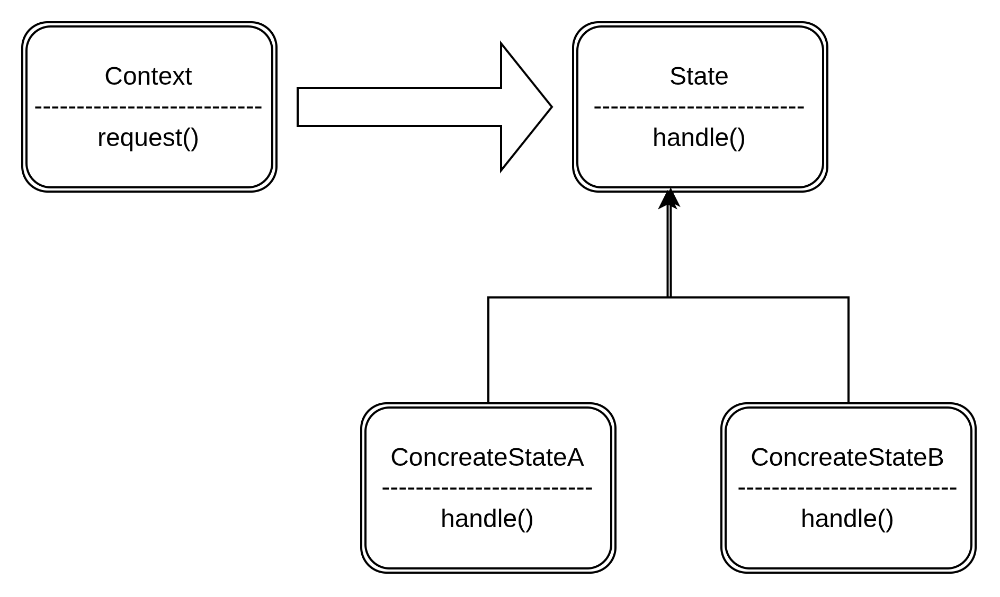

# State Pattern
The state pattern allows the __object__ behave differently when its state changes.



The canvas class is closed to modification but open to extension. This is __Open/Closed Principle_ from SOLID.


## Code explanation
This uses Polymorphism from OOPs.
The object behaves differently based on input.

Polymorphism: Is a mechanism that allows an object to take on many different forms.

With this implementation **we don't have long list of decesion making statements.**
Hence our application is **more maintainable and we can also easily extend it** to support different tools in the feature.

```typescript
import { Tool } from "./tool"

export class Canvas {
    constructor(private tool: Tool) {} // polymorphism - the Tool object can take many forms.

    mouseUp() {
        this.tool.mouseUp() // Here the canvas class is delegating to a specific tool to determine what should happen when a use presses or releases the mouse button.
    }

    mouseDown() {
        this.tool.mouseDown()
    }
}
```