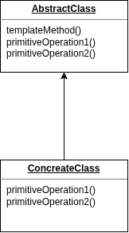

# [Template method pattern](https://www.geeksforgeeks.org/system-design/template-method-design-pattern/)

Because our **execute** method defines a template or 
skeliton for an operation.




We have an **abstract class** with a **template method** and a bunch of **primitive operations that are abstract**.

_so we have multiple abstract methods that are called by the template method()._

Now, we have a **concreate class** that extends the **abstract class and overrides or implements** the primitive operations.

BTW we _don't necessary needs to make the primitive methods are abstract_,
we can give them a **default implementation** and leave it upto the sub classes to determine if they wanna override the methods or not. In that case we refer those methods (privite methods with default implementaion in parent class) as **HOOKS**.


## Example: Audit Trail

```java

pubic class AuditTrail {
    record() {
        System.out.println('Audit');
    }
}

public abstract class Task {
    private AuditTrail auditTrail;

    pulic Task(AuditTrail auditTrail) {
        this.auditTrail = auditTrail
    }

    public void execute() {
        auditTrail.record();
    }

    public abstract void doExecute();
}

public class TransferMoneyTask extends Task {

    public TransferMoneyTask(AuditTrail auditTrail) {
        super(auditTrail)
    }

    @override
    public void doExecute() {
        System.out.println('Transfer Money.')
    }
}

```


## Example: with default contructor
`public Task(AuditTrail auditTrail) { this.auditTrail = audtiTrail}` Having the parameter in this constructor is useful if we are dealing with interface. so we could **decouple the task class from the audit trail class** and swap the implementaion of the  audit trail from the outside of the Task class.
```java

pubic class AuditTrail {
    record() {
        System.out.println('Audit');
    }
}

public abstract class Task {
    private AuditTrail auditTrail;

    // default constructor 
    public Task() {
        this.auditTrail = new AuditTrail()
    }

    public void execute() {
        auditTrail.record();
    }

    // to make it visible in sub class
    protected abstract void doExecute();
}

public class TransferMoneyTask extends Task {

    @override
    protected void doExecute() {
        System.out.println('Transfer Money.')
    }
}


public class Main {
    public static void main(string[] args) {
        var task = new TransferMoney();
        task.execute();
    }
}

```
