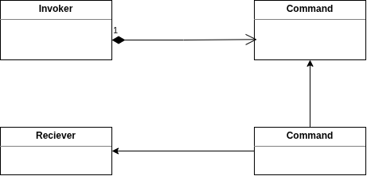

# [Command Pattern](https://www.geeksforgeeks.org/system-design/command-pattern/)

In command pattern we decouple the **invoker** from the **receiver**.

It turns a request or action into a standalone object, decoupling the code that triggers an action from the code that actually performs it.

with this structure the invoker can talk to this receiver without being aware of it.
This is the point of the command pattern.we uset it to **decouple** sender from the **receiver**.

There are more benifits to this pattern:

Because we are representing each request using the command object, there are number of things we can do with this command objects.
- We can pass them around in this code.
- we can pass them as arguments to the - methods.
- add them to a  list, for eg we can keep the track of all the commands executed, we can reply them or undo  them.
- also store these commands in the database and execute them in the future.
