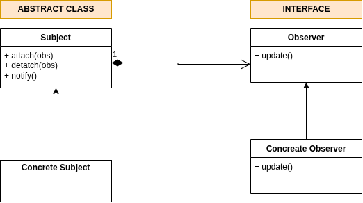
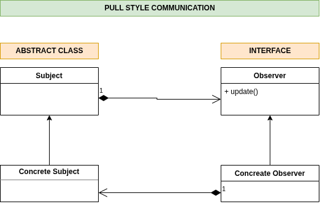

# Observer Pattern

When state of a class changes all the observers should be notified.

This is achieved using **Polymorphism**. (**loosly coupled**: the subject and observers are loosly coupled)

The Observer abstract class follows **Open and Closed Principle.**

This pattern is also called **Publish Subscribe** pattern,

because the **subject class** plays the role of a **publisher**. It publishes changes in its state, and **observers** are **subscribers** to those events.

## Communication styles

### PUSH STYLE
Updating the Observer interface: `update(value)`.

Diff observers might need diff types of data or fields to work with, so this is not flexible.

### PULL STYLE
The observers can pull the data they need. `getValue()`.

In this sytle ConcreateObserver depends on the ConcreateSubject for data.

Here coupling is introduced, but this is not a bad coupling, notice the direction of dependency.

concreateObserver &rarr; concreateSubject

