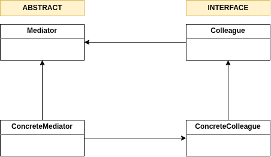
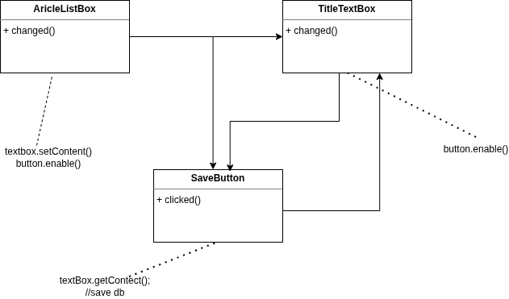
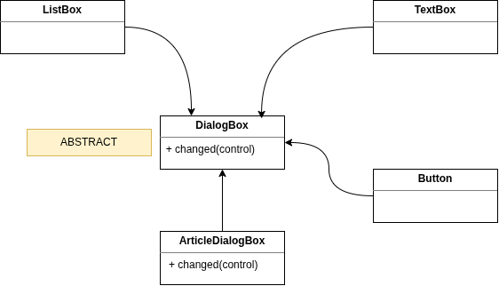
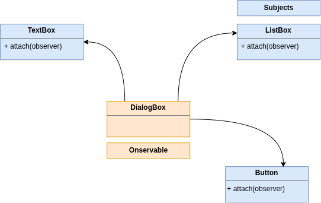

# Mediator Pattern

The mediater pattern is one of the important and widely used behavioral design pattarn
that centralizes the communication bitween object through a mediator object.

## UML Diagram from GoF book

We can have multiple concrete implementations of this interface (Colleague) and these are like out ListBox, TextBox and Button Classes.

The concreate implementations do not know anythings about each other.

They can talk to each other via mediator.

We are not coupling a listbox to  a text box or a button.

**The only type of coupling here is: coupling bw concreate mediator and the concreate colleague.**

& this is perfectly fine, because in a perticlular dialog box like the articles dialog box, we definately need to know about thec ontrols we have on that dialogbox.

## Communicatoin bw Objects Using Inheritance
One way to achive communication between the objects is using **inheritance**.

Suppose, we are building a GUI framework, we have a dialog box with a list box, a text box and a button.

If we use intheritance the logic is scattered all over the place, we have to refer multiple files/classes to undertand flow.

### Problem: 
As our form or dialog box gets more complecated will have more connections or depedencies bw the classes and as you can see the logic behind the Dialog Box is spread all over the place.

If I have to figure out what is happening in this dialog box I have to look diff classes.

As the dialog box bemcomes more complicated, understanding and maintaining becomes really difficult.

## Better Approach: Communication using Mediator
All objects communicate via mediator.

The **mediator object is a abstract class**, becuase how the objects will interact will differ from one dialog box to other.

### Problem: 
Too many decision making statements in `change()` method.

## Mediator Pattern Using Observer Pattern

