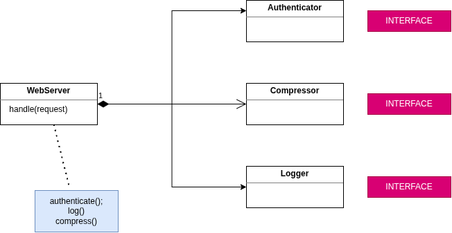
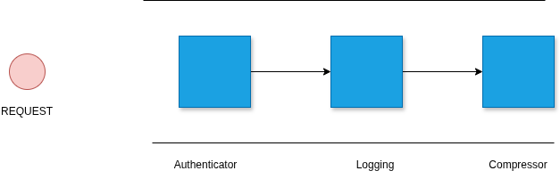
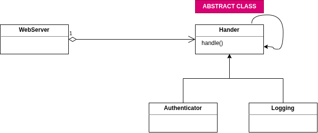

# Chain Of Responsibility

## Approach 1

```typescript
import { Authenticator } from "./Authenticator.class";
import { HttpRequest } from "./HttpRequest.class";

export class WebServer {
    handle(request: HttpRequest): void {
        // Authentication
        // Issue: If we instantiate an object with new keyword inside a class
        // the becomes tight coupling
        // one way to solve this problem is to make webserver class talk to an interface of each object (Approach #2)
        const authenticator = new Authenticator()
        authenticator.authenticate(request)
        // Logging
        // Compression
    }
}
```
## Approach 2

```typescript
class HttpRequest {
    constructor(private username: string, private password: string){}

    getUsername() {
        return this.username;
    }

    getPassword() {
        return this.password;
    }
}

// INTERFACE
interface AuthInterface {
    authenticate(request: HttpRequest): void
}

class Authenticator implements AuthInterface {

    authenticate(request: HttpRequest): void {
        const isValid = request.getUsername() ==  "admin" && request.getPassword() == "1234";
        if(isValid) {
            console.log('authenticated')
        }
    }
}

// INTERFACE
interface LoggerInterface {
    log(request: HttpRequest): void
}

class Logger implements LoggerInterface {

    log(request: HttpRequest): void {
        console.log('Log');
    }
}

// INTERFACE
interface CompressorInterface {
    compress(request: HttpRequest): void
}

class Compressor implements CompressorInterface {

    compress(request: HttpRequest): void {
        console.log('Compress');
    }
}

class WebServer {
    constructor(private authenticator: AuthInterface, private logger: LoggerInterface, private compressor: CompressorInterface) {}
    
    // Issue: the handle method is fixed, we can't add or remove a step here
    // to achive that we need to come back here and upate the handle() method everytime
    // hence this is a bad approach
    handle(request: HttpRequest) {
        this.authenticator.authenticate(request);
        this.logger.log(request);
        this.compressor.compress(request);
    }
}

function main() {
    const authenticator = new Authenticator();
    const logger = new Logger();
    const compressor = new Compressor();
    var server = new WebServer(authenticator, logger, compressor);
    server.handle(new HttpRequest("admin",  "1234"));
}

main();
```

With this structure of composition, still the `handle()` method is `WebServer` class is very fixed.

If we want to `disable` one of these steps, we have to modify the implementation of the handle method.

Also, if you want to add a new stop say `encription` at the start, middle,  or end again we have to come back and change the implementation of the handle method.

This violates the **Open Closed Principle**.

What we need is a processing pipeline.

## Approach 3


Chain of objects.

Each object only knows about the **next object in the chain**.

We can send our request though this pipeline.

request &rarr; authenticator &rarr; logging &rarr; compressor




### Implementation in code:
```typescript
class HttpRequest {
    constructor(private username: string, private password: string){}

    getUsername() {
        return this.username;
    }

    getPassword() {
        return this.password;
    }
}

// ABSTRACT CLASS
abstract class Handler {
    constructor(private next: Handler| null) {}

    handle(request: HttpRequest) {
        if(this.doHandle(request)) {
            return
        }
        if(this.next !== null) {
            this.next.handle(request)
        }
    }

    protected abstract doHandle(request: HttpRequest): boolean
}

// INHERITANCE
class Authenticator extends Handler {
    constructor(next: Handler) {
        super(next)
    }

    protected doHandle(request: HttpRequest): boolean {
        console.log('authentication')
        const isValid = request.getUsername() ==  "admin" && request.getPassword() == "1234";
        return !isValid;
    }
}

class Logger extends Handler {
    constructor(next: Handler){
        super(next)
    }

    protected doHandle(request: HttpRequest): boolean {
        console.log('Log');
        return false;
    }
}

class Compressor extends Handler {
    constructor(next: Handler | null){
        super(next)
    }

    protected doHandle(request: HttpRequest): boolean {
        console.log('Compress');
        return true;
    }
}

// USAGE
class WebServer {
    constructor(private handler: Handler){}

    handle(request: HttpRequest) {
        this.handler.handle(request)
    }
}

function main() {
    var compressor = new Compressor(null)
    var logging = new Logger(compressor)
    var authenticator = new Authenticator(logging)

    var server = new WebServer(authenticator);
    server.handle(new HttpRequest("admin","1234"));
}

main()

```