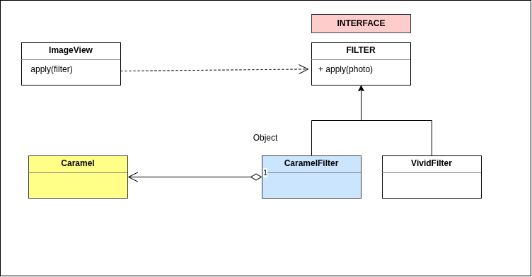

# Adaptor Pattern

Use it in situation where you have an existing class, you wana use it somewhere but
the interface of this class does not match the form we expect. We use the adaptor pattern to convert the interface of a class to different form.


## Solution
In the below diagarm

caramelFilter &rarr; adaptor & 
Caramel &rarr; adapte



## Code
```JavaScript
interface Filter {
    apply(): void
}

class CaramelFilter implements Filter {
    constructor(private caramel: Caramel){}
    apply(): void {
        this.caramel.applyFilter()   
    }
}

class Caramel {
    applyFilter() {
        console.log('caramel filter applied.')
    }
}

class ImageView {
    constructor(private filter: Filter) {}
    applyfilter() {
        this.filter.apply()
    }
}

class Main {
    constructor(args: []) {}

    static main() {
        var caramel = new Caramel()
        var caramelFilter = new CaramelFilter(caramel)
        var imageView = new ImageView(caramelFilter);
        imageView.applyfilter()

    }
}

Main.main();

```

## TakeAways:
Favour Composition Over Inheritance
