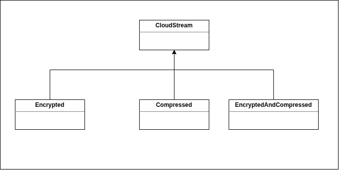
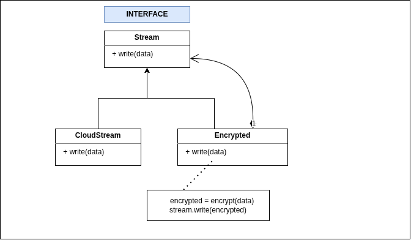

# Decorator Pattern

We use decorator pattern to add additional behaviour to an object.

## Without Decorator Pattern ( inheritance )    


```typescript
class CloudStream {
    write(data: string) {
        console.log('Storing ' + data);
    }
}

class EncryptedCloudStream extends CloudStream {

    write(data: string): void {
        var encrypted = this.encrypt(data);
        super.write(encrypted)
    }
    encrypt(data: string) {
        return "!@#(!@#*()@)(*!@"
    }
}

class CompressCloudStream extends CloudStream {
    write(data: string): void {
        const compressed = this.compress(data);
        super.write(compressed);
    }

    compress(data: string){
        return "compressed " + data;
    }
}

function main() {
    const cloudStream = new CompressCloudStream()
    cloudStream.write('hello');
}

main()
```

## Composition ( Decorator pattern )



```typescript
// INTERFACE
// all classes implements this interface
interface CloudStreamInterface {
  write(data: string): void;
}

// basic stream
class CloudStream implements CloudStreamInterface {
  write(data: string) {
    console.log(data);
  }
}

// Decorator 1
class EncryptedCloudStream implements CloudStreamInterface {
  constructor(private stream: CloudStreamInterface) {}
  write(data: string) {
    const encryptedData = this.encrypt(data);
    this.stream.write(encryptedData);
  }

  encrypt(data: string) {
    return "!@#(!@#*()@)(*!@";
  }
}

// Decorator 2
class CompressCloudStream implements CloudStreamInterface {
  constructor(private stream: CloudStreamInterface) {}
  write(data: string) {
    const compressedData = this.compress(data);
    this.stream.write(compressedData);
  }

  compress(data: string) {
    return "compressed " + data;
  }
}

// Usage
function storeCreditCard(stream: CloudStreamInterface) {
    stream.write('1234-1234-1234-1234')
}

storeCreditCard(new EncryptedCloudStream(new CompressCloudStream(new CloudStream()))) // output: compressed !@#(!@#*()@)(*!@
```

## Example 2
Coffee Maker

```typescript
interface CoffeeMaker {
    make(data: string): void
}

// BASE COFFEE MAKER
class BasicCoffee implements CoffeeMaker  {
    make(data: string): void {
        console.log(data);
    }
}


// DECORATOR 1
class AddMilk implements CoffeeMaker{
   
    constructor(private coffeeMaker: CoffeeMaker) {}

    make(data: string): void {
        const coffeeWithMilk = this.add(data);
        this.coffeeMaker.make(coffeeWithMilk);
    }

    add(data: string): string {
        return data  + " milk";
    }
}

// DECORATOR 2
class AddSugar implements CoffeeMaker {
    constructor(private coffeeMaker: CoffeeMaker) {}

    make(data: string): void {
        const coffeeWithSugar = this.add(data);
        this.coffeeMaker.make(coffeeWithSugar)
    }

    add(data: string) {
        return data + " sugar"
    }
}

// USAGE
function main () {
    const coffeeMaker = new AddSugar(new AddMilk(new BasicCoffee()));
    coffeeMaker.make('coffee ');
}

main()
```

### TakeAway
Favor `composition` over `inheritance`.